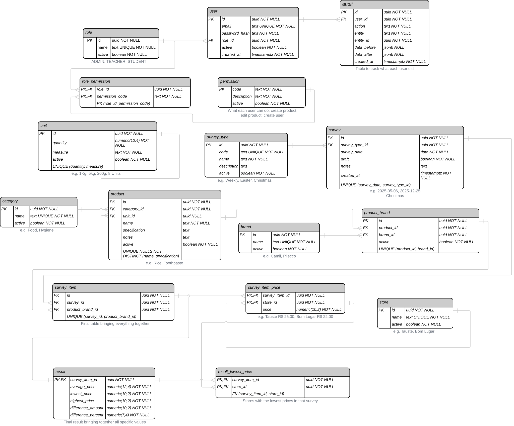

# Cesta Básica Sorocabana — API

> Backend da pesquisa de preços da cesta básica de Sorocaba: cadastro de produtos, marcas e mercados, controle de acesso por permissão e trilha de auditoria.

API REST que sustenta a pesquisa de preços da cesta básica em Sorocaba. Ela mantém o cadastro de tudo que entra numa coleta (produtos, marcas, categorias, unidades de venda, mercados e tipos de coleta), controla quem pode alterar cada coisa por meio de permissões e registra cada alteração com o estado anterior e o posterior.

> **Status:** os cadastros, o controle de acesso e a auditoria estão prontos. A coleta de preços (coletas, levantamentos, preços por mercado e cálculo do resultado) já tem modelo de dados e camada de persistência, mas ainda não tem rotas.

---

## Tecnologias

| Camada | Tecnologia |
|--------|-----------|
| Linguagem | Java 25 |
| Framework | Spring Boot 4.1 |
| Segurança | Spring Security + JWT (Auth0 java-jwt 4.4) |
| Banco de dados | PostgreSQL 16 |
| ORM | Spring Data JPA / Hibernate |
| Migrações | Flyway |
| Documentação | SpringDoc OpenAPI 3.1 (Swagger UI) |
| Containerização | Docker + Docker Compose |

---

## CI/CD

O repositório usa **GitHub Actions**:

- **Testes**: rodam em todo Pull Request e push para a `main`
- **Deploy**: a cada merge na `main` com os testes passando, a nova versão é publicada automaticamente no servidor

---

## Funcionalidades

- **Cadastros**: marcas, categorias, mercados, unidades de venda, tipos de coleta, produtos e vínculo produto + marca, com ativação e desativação em vez de exclusão.
- **Controle de acesso por permissão**: as permissões são definidas no código e sincronizadas com o banco na inicialização. Funções apenas agrupam permissões, e cada rota exige a permissão correspondente.
- **Administrador inicial**: criado na primeira inicialização a partir do `.env`, com todas as permissões. A função de administrador não pode ser alterada nem desativada.
- **Auditoria**: toda alteração grava quem fez, o que mudou e o registro antes e depois, em JSON. Senhas nunca entram no histórico.
- **Erros padronizados**: toda falha responde no mesmo formato, com mensagens em português.

---

## Arquitetura

O projeto segue a **Clean Architecture**, com as camadas de apresentação, aplicação, domínio e infraestrutura separadas. O domínio não depende de framework, e os identificadores (UUID) são gerados pelo próprio domínio.

```
src/main/java/br/uniso/cesta_basica_sorocabana/
├── presentation/          # Controllers REST, DTOs e tratamento de erros
├── application/           # Casos de uso e auditoria
├── domain/                # Entidades, enums (incluindo permissões) e ports (interfaces)
└── infrastructure/        # JPA, JWT, BCrypt, Spring Security, configuração
```

---

## Endpoints

Todas as rotas usam o prefixo `/api/v1` e exigem JWT no header `Authorization: Bearer {token}`, exceto o login. A coluna **Acesso** indica a permissão exigida; **logado** significa qualquer usuário autenticado.

A documentação completa, com exemplos de requisição e resposta, fica no Swagger UI (`/swagger-ui.html`).

### Autenticação
| Método | Rota | Descrição | Acesso |
|--------|------|-----------|--------|
| `POST` | `/auth/login` | Autentica e retorna o access token | público |

### Usuários
| Método | Rota | Descrição | Acesso |
|--------|------|-----------|--------|
| `GET` | `/users/me` | Dados e permissões do usuário autenticado | logado |
| `PATCH` | `/users/me/password` | Troca a própria senha | logado |
| `GET` | `/users` | Lista usuários (paginado) | `ADMIN` |
| `GET` | `/users/{id}` | Retorna um usuário | `ADMIN` |
| `POST` | `/users` | Cria um usuário | `ADMIN` |
| `PATCH` | `/users/{id}/role` | Troca a função do usuário | `ADMIN` |
| `PATCH` | `/users/{id}/password` | Redefine a senha de outro usuário | `ADMIN` |
| `PATCH` | `/users/{id}/activate` | Reativa um usuário | `ADMIN` |
| `PATCH` | `/users/{id}/deactivate` | Desativa um usuário | `ADMIN` |

### Funções e permissões
| Método | Rota | Descrição | Acesso |
|--------|------|-----------|--------|
| `GET` | `/roles` | Lista funções (paginado) | `ADMIN` |
| `GET` | `/roles/permissions` | Lista as permissões disponíveis | `ADMIN` |
| `GET` | `/roles/{id}` | Retorna uma função | `ADMIN` |
| `POST` | `/roles` | Cria uma função | `ADMIN` |
| `PATCH` | `/roles/{id}` | Edita nome e permissões | `ADMIN` |
| `PATCH` | `/roles/{id}/activate` | Reativa uma função | `ADMIN` |
| `PATCH` | `/roles/{id}/deactivate` | Desativa uma função | `ADMIN` |

### Marcas
| Método | Rota | Descrição | Acesso |
|--------|------|-----------|--------|
| `GET` | `/brands` | Lista marcas (paginado) | logado |
| `GET` | `/brands/{id}` | Retorna uma marca | logado |
| `POST` | `/brands` | Cria uma marca | `CREATE_BRAND` |
| `PATCH` | `/brands/{id}` | Edita uma marca | `UPDATE_BRAND` |
| `PATCH` | `/brands/{id}/activate` | Reativa uma marca | `UPDATE_BRAND` |
| `PATCH` | `/brands/{id}/deactivate` | Desativa uma marca | `UPDATE_BRAND` |

### Categorias
| Método | Rota | Descrição | Acesso |
|--------|------|-----------|--------|
| `GET` | `/categories` | Lista categorias (paginado) | logado |
| `GET` | `/categories/{id}` | Retorna uma categoria | logado |
| `POST` | `/categories` | Cria uma categoria | `CREATE_CATEGORY` |
| `PATCH` | `/categories/{id}` | Edita uma categoria | `UPDATE_CATEGORY` |
| `PATCH` | `/categories/{id}/activate` | Reativa uma categoria | `UPDATE_CATEGORY` |
| `PATCH` | `/categories/{id}/deactivate` | Desativa uma categoria | `UPDATE_CATEGORY` |

### Mercados
| Método | Rota | Descrição | Acesso |
|--------|------|-----------|--------|
| `GET` | `/stores` | Lista mercados (paginado) | logado |
| `GET` | `/stores/{id}` | Retorna um mercado | logado |
| `POST` | `/stores` | Cria um mercado | `CREATE_STORE` |
| `PATCH` | `/stores/{id}` | Edita um mercado | `UPDATE_STORE` |
| `PATCH` | `/stores/{id}/activate` | Reativa um mercado | `UPDATE_STORE` |
| `PATCH` | `/stores/{id}/deactivate` | Desativa um mercado | `UPDATE_STORE` |

### Unidades de venda
| Método | Rota | Descrição | Acesso |
|--------|------|-----------|--------|
| `GET` | `/units` | Lista unidades (paginado) | logado |
| `GET` | `/units/{id}` | Retorna uma unidade | logado |
| `POST` | `/units` | Cria uma unidade | `CREATE_UNIT` |
| `PATCH` | `/units/{id}` | Edita uma unidade (quantidade e grandeza) | `UPDATE_UNIT` |
| `PATCH` | `/units/{id}/activate` | Reativa uma unidade | `UPDATE_UNIT` |
| `PATCH` | `/units/{id}/deactivate` | Desativa uma unidade | `UPDATE_UNIT` |

### Tipos de coleta
| Método | Rota | Descrição | Acesso |
|--------|------|-----------|--------|
| `GET` | `/survey-types` | Lista tipos de coleta (paginado) | logado |
| `GET` | `/survey-types/{id}` | Retorna um tipo de coleta | logado |
| `POST` | `/survey-types` | Cria um tipo de coleta | `CREATE_SURVEY_TYPE` |
| `PATCH` | `/survey-types/{id}` | Edita um tipo de coleta (código, nome e descrição) | `UPDATE_SURVEY_TYPE` |
| `PATCH` | `/survey-types/{id}/activate` | Reativa um tipo de coleta | `UPDATE_SURVEY_TYPE` |
| `PATCH` | `/survey-types/{id}/deactivate` | Desativa um tipo de coleta | `UPDATE_SURVEY_TYPE` |

### Produtos
| Método | Rota | Descrição | Acesso |
|--------|------|-----------|--------|
| `GET` | `/products` | Lista produtos (paginado) — filtro opcional `?categoryId=` | logado |
| `GET` | `/products/{id}` | Retorna um produto | logado |
| `POST` | `/products` | Cria um produto | `CREATE_PRODUCT` |
| `PATCH` | `/products/{id}` | Edita um produto (categoria, unidade, nome, especificação e notas) | `UPDATE_PRODUCT` |
| `PATCH` | `/products/{id}/activate` | Reativa um produto | `UPDATE_PRODUCT` |
| `PATCH` | `/products/{id}/deactivate` | Desativa um produto | `UPDATE_PRODUCT` |

### Produto + marca
| Método | Rota | Descrição | Acesso |
|--------|------|-----------|--------|
| `GET` | `/products/{productId}/brands` | Lista as marcas vinculadas ao produto | logado |
| `POST` | `/products/{productId}/brands` | Vincula uma marca ao produto | `CREATE_PRODUCT_BRAND` |
| `GET` | `/product-brands/{id}` | Retorna um vínculo | logado |
| `PATCH` | `/product-brands/{id}/activate` | Reativa um vínculo | `UPDATE_PRODUCT_BRAND` |
| `PATCH` | `/product-brands/{id}/deactivate` | Desativa um vínculo | `UPDATE_PRODUCT_BRAND` |

### Auditoria
| Método | Rota | Descrição | Acesso |
|--------|------|-----------|--------|
| `GET` | `/audits` | Lista o histórico (paginado). Filtros opcionais e combináveis: `entity` (`ALL` por padrão, ou `BRAND`, `PRODUCT`…), `entityId`, `userId` | `VIEW_AUDIT` |
| `GET` | `/audits/{id}` | Retorna um registro com os dados antes e depois | `VIEW_AUDIT` |

---

## Rodando localmente

### Pré-requisito

- Docker e Docker Compose

### 1. Clone o repositório

```bash
git clone git@github.com:IDeath-Z/Cesta-Basica-Sorocabana.git
cd Cesta-Basica-Sorocabana
```

### 2. Configure as variáveis de ambiente

```bash
cp .env.example .env
```

Preencha o `.env` (veja a tabela em [Configuração](#configuração)). `ADMIN_EMAIL` e `ADMIN_PASSWORD` definem o administrador criado na primeira inicialização. Troque a senha dele depois, pela rota `PATCH /api/v1/users/me/password`.

### 3. Suba os containers

O Docker faz o build da aplicação e sobe o banco. O arquivo `compose.dev.yaml` expõe as portas no host:

```bash
docker compose -f compose.yaml -f compose.dev.yaml up -d --build
```

### 4. Acesse

- API: `http://localhost:8080/api/v1`
- Swagger UI: `http://localhost:8080/swagger-ui.html`
- PostgreSQL: `localhost:5433`

Faça login com o administrador em `POST /api/v1/auth/login` e use o `accessToken` retornado no botão **Authorize** do Swagger.

### Produção

```bash
docker compose -f compose.yaml -f compose.prod.yaml up -d --build
```

O override de produção usa um volume persistente para o banco, reinicia os containers automaticamente e roda o Hibernate em modo `validate`.

---

## Configuração

| Variável | Descrição | Padrão |
|----------|-----------|--------|
| `DB_NAME` | Nome do banco PostgreSQL | — |
| `DB_USER` | Usuário do banco | — |
| `DB_PASSWORD` | Senha do banco | — |
| `JWT_SECRET` | Segredo usado para assinar os tokens | — |
| `JWT_EXPIRATION_MINUTES` | Validade do access token, em minutos (não há refresh token) | `120` |
| `ADMIN_EMAIL` | E-mail do administrador inicial (vazio desativa a criação) | — |
| `ADMIN_PASSWORD` | Senha inicial do administrador, usada só na primeira inicialização | — |
| `ADMIN_ROLE_NAME` | Nome da função de administrador, que recebe todas as permissões | `ADMIN` |
| `SWAGGER_ENABLED` | Liga ou desliga o Swagger UI e o `/v3/api-docs` | `true` |
| `CORS_ALLOWED_ORIGIN_PATTERNS` | Origens permitidas no CORS, separadas por vírgula | `http://localhost:*` |

---

## Modelo de dados



O schema é criado pelo Flyway (`src/main/resources/db/migration`). Todas as chaves são UUID.

- **Cadastros**: `product` (categoria, unidade opcional, nome e especificação únicos em conjunto), `brand`, `category`, `unit` (quantidade + grandeza, ex.: 5 kg), `store`, `survey_type` e `product_brand` (o par produto + marca que entra na pesquisa)
- **Coleta**: `survey` (uma coleta por data e tipo), `survey_item` (produto + marca dentro da coleta), `survey_item_price` (preço em cada mercado), `result` e `result_lowest_price` (média, menor e maior preço, diferença e os mercados com o menor preço)
- **Acesso**: `user`, `role`, `permission` (gerada a partir do código) e `role_permission`
- **Auditoria**: `audit`, com o autor, a ação, a entidade e os dados antes e depois em JSONB

---

## Testes

<!-- TODO: os testes automatizados ainda não foram implementados. -->
O projeto tem por enquanto apenas o teste de carregamento do contexto. Ele precisa de JDK 25, do `.env` configurado e do PostgreSQL de desenvolvimento rodando em `localhost:5433` (passo 3 de [Rodando localmente](#rodando-localmente)):

```bash
./mvnw test
```

---
